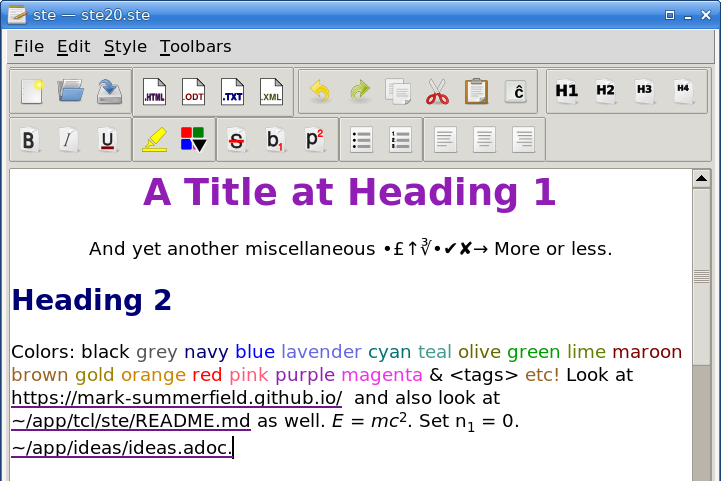

# Styled Text Edit — ste

A GUI Tcl/Tk styled text editor that supports bold, italic, color, etc.

ste supports conventional keyboard shortcuts, _Ctrl+I_ for italic, etc.

To get a bullet item use _Ctrl+Tab_ or for a numbered item _Ctrl+1_ or for a
plain indent _Tab_. To unindent either use _Backspace_. If _Tab_ is used
just after one or more letters auto-completion is attempted. This is based
on a few hundred common English 5+ letter words plus the words already
present.

There is support for simple numbered lists and for up to three levels of
bullet lists. There is no support for images or tables.

Seven user-defineable fonts are supported, three body fonts, Sans, Serif,
and Mono, and four heading fonts (H1 to H4), each with its own font family
and size and each with sensible defaults (Helvetica for Sans and the
headings, Times for Serif, and Courier for Mono).

The HTML import and export are very basic and printing only handles plain
text. For printing it is best to export to Open Document Format (.odt) since
that preserves fonts, colors, and formatting.

The load and save of files in .ste (ste's own format), .tkt (the Tcl/Tk text
widget's dump format), and .tktz (zlib deflated Tcl/Tk text widget dump
format) works with perfect fidelity, although only .ste format preserves
custom font families and sizes.

Note: I use [Store](https://github.com/mark-summerfield/store) for version
control so github is only used to make the code public.

Note: Claude AI was used for the import and export code (except for plain
text) and for the font family and size code.

## Dependencies

Tcl/Tk >= 9.0.3; Tcllib >= 2.0; Tklib >= 0.9.

## License

GPL-3

---
